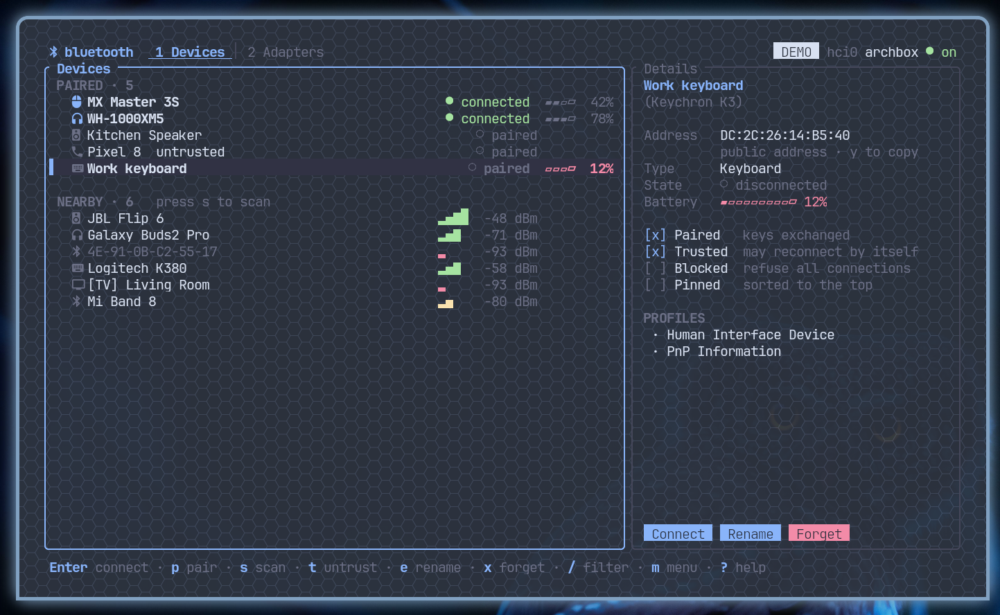

# bluetooth-tui



A terminal Bluetooth manager for BlueZ, written in Rust with [ratatui](https://ratatui.rs).

- Paired and nearby devices in one list, with battery level and signal strength
- Pair, connect, trust, block, rename, forget and pin devices
- Built-in pairing agent for PIN, passkey and confirmation prompts
- Adapter power, visibility, pairing and name
- Event-driven over D-Bus; nothing polls
- Mouse and keyboard throughout

## Install

### Arch Linux

A PKGBUILD is in [`packaging/`](packaging/PKGBUILD):

```sh
git clone https://github.com/adelmonte/bluetooth-tui
cd bluetooth-tui/packaging
makepkg -si
```

### From source

Needs Rust 1.85+ and the D-Bus development files.

```sh
cargo build --release
install -Dm755 target/release/bluetooth-tui ~/.local/bin/bluetooth-tui
```

At runtime it needs BlueZ.

## Usage

```
bluetooth-tui [--demo] [-c|--config PATH] [--print-default-config]
```

| Option | |
|---|---|
| `--demo` | Run with fake devices |
| `-c`, `--config PATH` | Use a config file other than `~/.config/bluetooth-tui/config.toml` |
| `--print-default-config` | Print the default config and exit |

### Keys

| Key | Action |
|---|---|
| `1` / `2`, `Tab` | Devices / Adapters |
| `j` / `k`, `↓` / `↑` | Move |
| `Enter` | Connect / disconnect |
| `s` | Scan |
| `p` | Pair |
| `t` | Trust / untrust |
| `x` | Forget |
| `f` | Pin to top |
| `o` | Adapter power |
| `/` | Filter |
| `:`, `Ctrl-P` | Command palette |
| `?` | All keys |

## Configuration

`~/.config/bluetooth-tui/config.toml` is created on first run with every option commented: icons, colors, key bindings, scanning and pairing behavior.

## License

GPL-3.0-or-later
